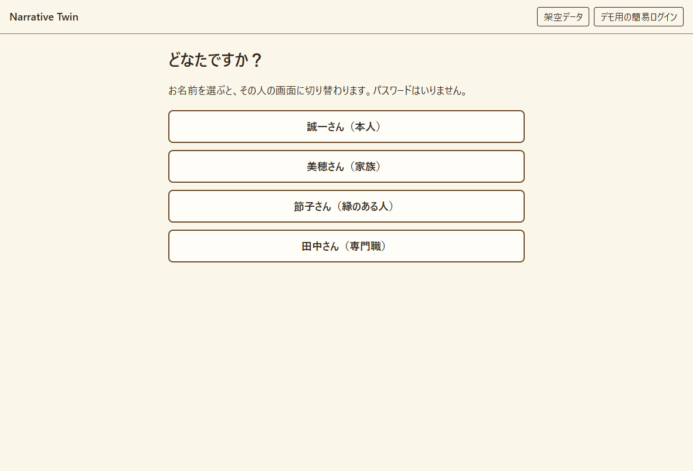

# Narrative Twin

日記と写真をきっかけに、相棒のAI「ツイン」が本人と会話し、家族や縁のある人とも分かち合いながら、本人の人生と価値観を記録するアプリの試作品です。Built with Claude: Japan 2026 の提出作品（テーマ1「あなたにしかない深さを。」）です。

人物・写真・記録はすべて架空です。



## いま動くもの

| 機能 | 内容 |
|---|---|
| デモ用の簡易ログイン | 名前を選ぶだけで、4人それぞれの空の画面に切り替わる。パスワードはない |
| 言明の台帳 | 追記だけの記録。訂正も新しい行として追記し、元の行を指す |
| 共有範囲の絞り込み | ログイン中の人に見てよい記録だけを、サーバーが返す。画面はまだ記録を表示しない |
| 言明に分ける処理 | 会話やスレッドの発言を、Claude API で言明に分ける。本人の言葉は文の切れ目で切った原文の抜き出しだけを入れる。画面からはまだ呼ばない |
| 写真の問い | 写真を1枚渡すと、本人に問いかける文を1つ返す |
| 自動テスト | 上の決まりを pytest で確かめる |

ツインとの会話、意思モデル、ツインの姿の画面は、まだありません。

## 起動のしかた（Windows の PowerShell）

Python 3.13 で確かめました。次のコマンドは、このフォルダで実行します。

```powershell
# 1. 作業用の環境を作り、必要な部品を入れる（最初の1回だけ）
python -m venv .venv
.venv\Scripts\python -m pip install -r requirements.txt

# 2. 起動する
.venv\Scripts\python -m app
```

起動したら、ブラウザで <http://127.0.0.1:8000> を開きます。止めるときは、PowerShell で `Ctrl + C` を押します。

データは `data/narrative_twin.db` に保存されます。最初の起動のときに自動で作られ、Git には入りません。

## テストのしかた

```powershell
.venv\Scripts\python -m pytest
```

キーもネットの接続もいりません。テストは本物のデータベースに触れず、毎回一時的なものを使います。

## Claude への接続確認

起動とテストにはキーはいりません。Claude API を使うときだけ、`.env.example` を `.env` という名前で写し、自分のキーを書きます。`.env` は Git に入りません。

```powershell
.venv\Scripts\python -m app.ai
```

決まった短い文を Claude API に1回送り、キーと通信を確かめます。少額の費用がかかります。

## フォルダの中身

| 場所 | 内容 |
|---|---|
| `app/` | サーバーのコード。AIを呼ぶ層（`ai.py`）と、決まった手順で動く層（`ledger.py`、`consent.py`）を分けている |
| `static/` | 画面（HTML / CSS / JavaScript） |
| `tests/` | 自動テスト |
| `docs/` | 仕組みの説明と、作業の記録 |

## 詳しい説明

- [仕組みの説明](docs/architecture.md)：全体の図、台帳の決まり、見える範囲の表、名前の対応
- [画面とサーバーの取り決め](docs/api.md)
- [モデルと機能の表](docs/tools.md)：役割、選んだ理由、選ばなかった案、実測
- [作業の記録](docs/worklog.md)
- [決めたことと、やめたこと](docs/decisions.md)

## ライセンス

提出までに決めます。
