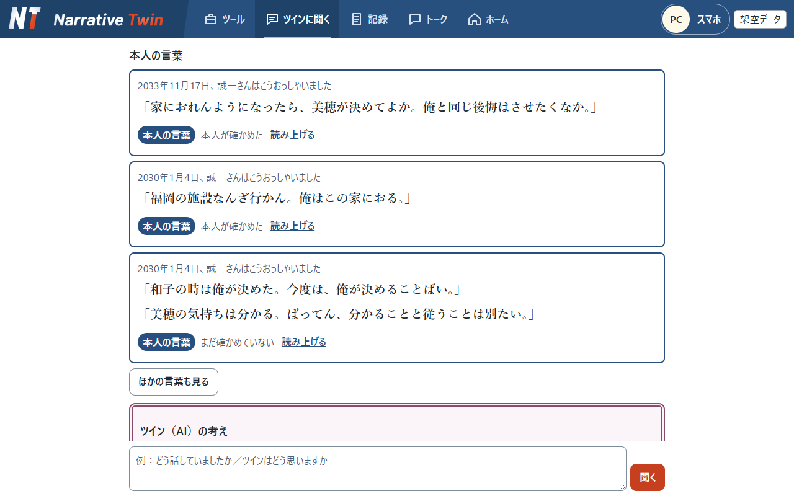
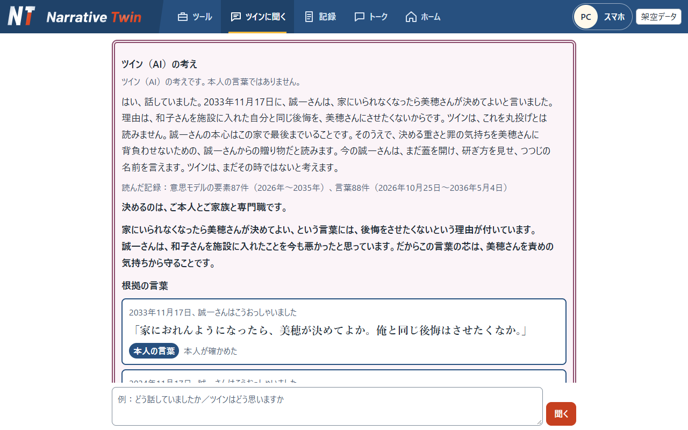

<picture>
  <source media="(prefers-color-scheme: dark)" srcset="static/brand/narrativetwin-logo-on-dark.svg" />
  
</picture>

# Narrative Twin

言葉は本人のもの。考えはツインのもの。決めるのは人。

**解決する困りごと**：本人が自分の言葉で話せなくなると、家族とケアマネジャーは「本人ならどうしたいか」を、本人の言葉なしで決めることになります。Narrative Twin は、話せるうちの日記と会話を積み上げ、必要なときに本人の言葉を一字も変えずに届けます。

**誰のためのものか**

| 人 | することができる |
|---|---|
| 本人 | 日記と写真を入れ、相棒のAI「ツイン」と話す。推測を直し、どの話を誰に託すかを決める |
| 家族と縁のある人 | タイムラインとトークで分かち合う。託された家族は、ツインに本人の言葉を聞ける |
| ケアマネジャー | 本人の言葉を、日付と出どころつきで受け取る。ツインの考え、ケアプラン案、1枚の紙を使う |

**デモ動画**：https://youtu.be/suv638PMKpk （YouTube の限定公開。長さ 2分59秒（178.97秒）。YouTube の画面では切り上げて 3:00 と出ることがあります）。動画の内容（場面ごとの画面、ナレーション、テロップ、フリップ）は [docs/video.md](docs/video.md) にあります（公開版では、一部の説明を省いています）。同じ中身の HTML 版は [docs/video.html](docs/video.html)（ダウンロードしてブラウザーで開きます）。

**触れるデモ（期間限定。2026-11-10（火）の午後まで）**：https://diameter-respondent-location-clouds.trycloudflare.com 。一般ゲストのパスワードは `guest01` です（見るだけで、書き込みと AI は使えません）。人物と記録はすべて架空で、毎時0分に最初の状態に戻ります。つながらないときは、下の「キーなしで動かす」の手順で、手元でも開けます。



Built with Claude: Japan 2026 の提出作品（テーマ1「あなたにしかない深さを。」）の試作品です。提出物とデモの人物・写真・記録はすべて架空です。投稿の写真とプロフィールの顔は、AI（Codex の image_gen）で作った架空の写真と人物です。文章の指示だけで作り、実在の写真を参考にしていません。

## はじめに読むところ

- **作った人**：介護現場でケアマネジャーの業務を26年行っている tyumajinさん（1人）。コードは Claude Code で書いた（「Claude Code で作りました」の節）。
- **課題**：高齢で病気や認知症になると、本人の声は届きにくくなる。介護の理念は本人中心（パーソン・センタード・ケア）なのに、現実には本人の過去を知らない専門職や家族の意向が優先されがちになる。当事者はそれを「認知症になったらアンコウにされる」と表した。日本の認知症の高齢者は、2025年に約472万人、2040年に約584万人（65歳以上の約6.7人に1人）と推計されている（厚生労働省の研究班、2024年5月公表）。
- **解き方**：元気なうちから日々の言葉を積み、必要なときに本人の言葉を一字も変えずに届ける。話せなくなったあとは、ツインが本人として代弁する。一度書いて終わるエンディングノートと違い、揺れ動く気持ちに長く伴走する。日本の高齢者には、家族に遠慮して「迷惑をかけたくない」「どこでもいい」と本音を飲み込む人が少なくない。ツインは、その言葉の裏にありそうな本音を、日々の対話の中で仮説としてすくい取り、本人に確かめる。
- **これまでとの違い**：これまでは、話せなくなった本人の思いを、家族の記憶と専門職の推測で補うしかなかった。Narrative Twin は、記録にある本人の言葉を日付と出どころつきでそのまま届け、記録にないことは「まだ聞けていません」と答える。
- **医療の助言はしない**：病気の診断と服薬の指示はしない（`app/medical.py` で、AI への指示と、言い切りの照合の2段で止める）。本人の暮らしの価値観と意向を分かち合う意思決定支援の道具で、決めるのはご本人とご家族と専門職。
- **Claude の使い方で新しいこと**：届く言葉は AI が書かない（AI は番号を選び、本文はプログラムが記録から入れる）。AI の読みはすべて仮説として本人の言葉と分けて持ち、確からしさは AI ではなくプログラムが式で計算する。返事は、AI が書いた文をプログラムが文ごとに確かめてから出す。
- **作り方**：Claude Code で 2026-11-02 から 11-08 の7日間。マージ以外のすべてのコミットに Claude の共同作者。自動テスト 2,511件が、API キーもネットもなしで通る。
- **測ったこと**：セルフの答えを、調整で一度も見ていない確認用の問い（8問）で測った。セルフ 0.578、BM25 の RAG 0.469 で、差 0.109 は、同じ仕組みを2回測ったぶれ 0.062 より大きい。意思モデルとの差 0.031 はぶれの中。詳しくは [docs/verification/selfhood/README.md](docs/verification/selfhood/README.md)。
- **大事にしていること**：最後に大事なのは、人と人の絆。家族や友人との日々のトークと便り、本人がツインと書いて送る手紙は、その絆を育てる仕掛けとして作った。AI が発展しても、最後は人。この AI が届けるのは、人の心。
- **ハッカソンのあと**：作った tyumajinさんが、自分の記録で使い続ける（`--mine`）。まず自分の現場の利用者とケアマネジャーから使い、地域の仲間にも広げる（「[ハッカソンのあと](#ハッカソンのあと)」の節）。

## 根拠の場所

| 見るところ | 根拠の場所 |
|---|---|
| 課題 | この README の「解決する困りごと」。動画の第1幕（[docs/video.md](docs/video.md)） |
| デモ | 動画（[docs/video.md](docs/video.md)）。この README の「キーなしで動かす」と「10年後の場面までたどる」。実行結果の見本 [docs/examples.md](docs/examples.md)。画面での確かめ [docs/verification/README.md](docs/verification/README.md) |
| Claude の使い方 | この README の「Claude の使いどころ」。役割ごとのモデルと機能、選んだ理由、実測の表 [docs/tools.md](docs/tools.md)。モデルの選択を1か所にまとめた `app/config.py`。アプリの中で Claude を呼ぶのは `app/ai.py` だけ（比べの道具 `scripts/compare_twin_effort.py` と `scripts/compare_twin_voice.py` は別に呼ぶ） |
| Claude Code での作り方 | この README の「[Claude Code で作りました](#claude-code-で作りました)」。`.claude/`（サブエージェント4つ、フック2つ、スキル1つ）と `CLAUDE.md`。[docs/tools.md](docs/tools.md) の「Claude Code で作ったことで、できるようになったこと」。コミットの共同作者（Co-Authored-By） |
| 作り込み | 守る約束のテスト（`tests/test_verbatim.py` 本人の言葉の一字一句の照合、`tests/test_consent.py` 見える範囲の絞り込み、`tests/test_ledger.py` 追記だけの台帳）。仕組みの説明 [docs/architecture.md](docs/architecture.md)。BM25 の RAG との比べ [docs/verification/rag_compare_report.md](docs/verification/rag_compare_report.md)。セルフが本人に近づいたかの測り [docs/verification/selfhood/README.md](docs/verification/selfhood/README.md)（第0〜第8ラウンド）。決めたことと、やめたこと [docs/decisions.md](docs/decisions.md) |

## 見せ場

1. **本人の言葉は一字も変えずに届く。** ケアマネジャーの問いに、記録の本文のまま、日付と出どころをつけて返す。AI は番号を選ぶだけで、本文はプログラムが記録から取り出す。
2. **聞けていないことは「まだ聞けていません」と答える。** 推定を出すときは本人の言葉と別の枠に出し、根拠、反対の根拠、確からしさ、確かめ方を付ける。
3. **本人の訂正で、ツインの推測が変わる。** 推測に「そうです／ちがいます／今は話したくない」で答えられる。直しても元の記録は消えず、確かめた分だけ花びらに色がのる。
4. **本人が話せなくなったあとも、ツインが本人の言葉を根拠に主張する。** ツインの考え（専門職の問いへの代弁）は、ツインが本人として一人称で話し、枠に「ツイン（AI）が本人として代弁しています。推測を含みます。」と必ず出す。ケアプラン案への異議と1枚の紙は、主語をツイン（AI）にして本人になりきらない。決めるのはご本人とご家族と専門職。
5. **託す人と見せる範囲は本人が決める。** 「本人だけ」の記録は、本人以外には件数も見せない。

## キーなしで動かす

API キーがなくても、10年分の記録、写真、保存した案A、B、Cが開きます。AI は呼びません。Windows の Python 3.13 で確かめました。

Windows：

```powershell
git clone （このリポジトリ）
cd narrative-twin
python -m venv .venv
.venv\Scripts\python -m pip install -r requirements.txt
.venv\Scripts\python -m app
```

Mac と Linux（未確認です）：

```bash
git clone （このリポジトリ）
cd narrative-twin
python3 -m venv .venv
.venv/bin/python -m pip install -r requirements.txt
.venv/bin/python -m app
```

<http://127.0.0.1:8000> を開きます。最初の起動で `data/select/` を読み込み、2036年5月6日の場面で開きます。止めるときは `Ctrl + C` を押します。

新しい問いに本物の AI で答えるときは、`.env.example` を `.env` に写してキーを書きます。キーがないと、ツインとの部屋では「ツインと話すには API キーが要ります」、ほかの問いでは「いま、うまくお答えできませんでした」と出ます。

## デモと新規の違い

| | デモ | 新規 | 自分の記録 |
|---|---|---|---|
| 始め方 | 入口で名前を押す | 入口の「新規で始める」を押す | `python -m app --mine` で起動する |
| 中身 | 誠一さんたちの10年分（架空） | 何もない状態。「はじめまして」で本人を登録する | 何もない状態。最初の起動で本人を登録する |
| API キー | 開くだけなら要らない | ツインと話すには要る。登録とホームは要らない | ツインと話すには要る |
| 今日の日付 | 物語の2036年5月6日 | 本当の今日 | 本当の今日 |
| 保存先 | `data/narrative_twin.db`、`data/photos/` | `data/fresh/<番号>/` | `data/mine/` |
| ポート | 8000 | 8000 | 8001 |
| 画面の隅 | 架空データ | 新規のデータ | 自分の記録で試用中 |

デモの10年分は、台本を、画面から入れるのと同じ処理に日付順で流して作りました。できた結果を `data/select/` に入れているので、キーがなくても開きます。新規では同じ処理がその場で動くので、使うには API キーが要ります。

どの画面からでも「ログイン画面」で入口へ戻れます。新規は何度でも作れます。前の新規は消えず、入口の一覧から開けます。新規を作っても、デモの10年分は変わりません。`data/fresh/` は Git に入りません。

自分の記録の起動（`--mine`）には、「ログイン画面」も「新規で始める」もありません。

## 10年後の場面までたどる

名前を押すと、その人の画面になります。パスワードはありません。


1. **田中さん（ケアマネジャー）**：最初に「ツール」のタブが開きます。
   - 「ツインにたずねる」で問いを入れると、ツイン（AI）がセルフをもとに本人として代弁で答え、本人の言葉は代弁を補強するときだけ記録の本文のまま添えます。保存した問いと答えも読めます。問いに合う本人の言葉が記録にないときは、代弁の前に「この話は、記録にはありません。ここからはツインの推測です。」と出ます。
   - 「資料を渡してチェックする」で、ケアプランやアセスメントの PDF をツインが本人のセルフをもとにチェックします。アセスメントなどの入力も、このカードから開きます。
   - 「書類を作る」で、生活まとめプランと、本人に代わって書く A4 1枚の手紙を頼めます。手紙は、ご本人かご家族が読んで修正してから届きます。
   - ツールの「ツインにたずねる」の下の「ケア会議」で、今の様子と字幕の画面になります。会議の画面では、問いに合う本人の言葉を記録の本文のまま日付と出どころつきで出し、なければ「まだ聞けていません」と答えます（主治医など、職種のツールがない専門職は、ツールの画面の「ケア会議」のカードで開きます）。
2. **誠一さん（本人）**：ホームにつながりの地図と家系図があります。「トーク」のツインとの部屋に10年分の会話があり、「タイムライン」に便りが、「記録」に日付ごとの記録があります。
3. **美穂さん（託された家族）**：「ツインに聞く」で、ツインの代弁と、理由ごとに添えた本人の元の言葉を読めます。ツールはありません。
4. **井ノ口先生（主治医）**：物語では、田中さんを招いた日（2036年1月18日）に本人から託されています。そのため「ツインに聞く」と「記録」が見え、ツールの画面の「ケア会議」のカードから会議を開けます。託される前は、入っている部屋の話だけが見えます。



## 5つの花びら

ツインの姿の5枚の花びらは、パーソン・センタード・ケアで、その人らしさ（パーソンフッド）を保つために満たされるべきとされる、トム・キットウッドの5つの心理的ニーズにあたります。くつろぎ、結びつき、共にあること、たずさわること、自分らしさの5つです（`app/schemas.py` の `Petal`）。

- 花びらを押すと、その花びらについて「何で満たされるか」「何で損なわれるか」「今どうか」の3つの面のツイン（AI）の読みと、根拠になった本人の言葉（記録の本文のまま、日付と出どころつき）が出ます。読みはセルフに保存した仮説で、画面を開いたときに AI は呼びません。根拠の言葉は、見る人に見える記録だけです（`app/petals.py`、`static/petals.js`）。
- 読みを見られるのは、本人（ホームの「5つの花びら」）と、託された専門職（「記録」の画面）です。家族と縁のある人には返しません。
- 花びらの色は、本人が確かめた根拠を持つ要素の分だけのります。うすい、中くらい、こいの言葉で返し、数字や割合は出さず、使わなくても減りません（`app/growth.py`）。

## Claude の使いどころ

回数の多い処理は Haiku 5.5、写真を読む処理、月ごとの固める処理、専門職の問いに答える処理は Sonnet 5.5、年と人生の段階の固める処理、推定意思、ツインの考えは Opus 5.5 です。ツインの会話は、心の目次ができてからは、すべての返事を Sonnet 5.5 で書きます（Haiku 5.5 は同じ目次を渡しても言い直しに戻ったため）。心の目次がないあいだは、発言の中身と Haiku 5.5 の答えをプログラムが判断し、相談や気持ちの話など必要なときだけモデルを Sonnet 5.5 へ選択します（`app/twin.py` の `choose_turn`、`app/twin_model.py`）。処理ごとに、Claude が担うこと、プログラムが確かめること、本人が決めることを [docs/tools.md](docs/tools.md) に分けて書いています。

基本の使い方と違う点は次のとおりです。

- **届く言葉は AI が書かない。** AI が返すのは番号と短い案内だけで、本文はプログラムが記録から取り出す。本人の言葉の型に本文の項目がないので、AI の出力が本人の言葉になる道がない（`app/advocacy.py`、`app/verbatim.py`）。
- **過去の言葉の意味を踏まえて返す。** 本人の言葉を月ごとに読み直し、人とテーマの「心の目次」に固めておく。返事は、名簿と心の目次をプロンプトキャッシュで渡して1回で書かせ、プログラムが文ごとに確かめる。最近のログを渡すだけの形では、「妻」がだれかも分からなかった（`app/twin.py` の `respond_in_twin_room`、`app/heart.py`、[docs/tools.md](docs/tools.md) の「ツインとの会話エンジン」）。
- **セルフ生成エンジン。** 記録を読み、本人の人物像を盤面として組み上げる。読みはすべて仮説として持ち、本人の言葉とは分ける。次の言葉が仮説を支えるか反するかを確かめ、外れたら直す。家族の言葉にある気持ちは家族のもので、本人の気持ちに数えない。確からしさは AI に決めさせず、根拠の重みからプログラムが計算する（（支え＋1）÷（支え＋反証＋2）。本人が確かめた言葉と本人の訂正がいちばん重く、古い根拠の重みは3年で半分になる（5年以上続く支えは、変わらない芯として減らさない））。問いが来る前に本人を組み上げておく（`app/selfhood.py` の盤面と重みと確からしさ、`app/selfhood_prompts.py` の読み方の決まり、`app/selfhood_stages.py` の段、[docs/architecture.md](docs/architecture.md) の「セルフ生成エンジン」）。
- **本人の訂正で推測が変わる。** 訂正は台帳に新しい行として追記し、元の行を指す。固め直すと意思モデルが変わり、次の問いと答えに効く（`app/ledger.py`、`app/consolidate.py`）。
- **専門職が渡した資料（PDF）を Claude が読む。** ケアプランやアセスメントの PDF を文書のブロックとして渡し、Sonnet 5.5 が観察と聞き取りに分ける。資料の中の「本人：〜」は専門職の聞き取りとして扱い、本人の言葉にしない。専門職が残すと決めた項目だけが記録になる。取り込んだケアプランは、ツインがセルフをもとにチェックする。PDF の渡し方は、設計の前に Claude Code の `claude-api` スキルで今の決まりを確かめた。写真と同じ呼び出しの形で渡せること、スキャンした紙も読めること、引用の位置を返す機能は答えの形を決める機能と同時に使えないことが分かり、ページ番号は AI の答えを使って原文との照らしを別の段にした（`app/professional_records.py`）。
- **本人が話せなくなったあとに、ツインが本人の言葉を根拠に主張する。** ツインの考えは本人の言葉とは別の枠に出し、ツインが本人として一人称で代弁する。枠には「ツイン（AI）が本人として代弁しています。推測を含みます。記録された本人の言葉ではありません。」と必ず出す。本人の言葉は番号で指し、本文はプログラムが入れる（`app/advocacy_voice.py`）。

作り方の数字は [docs/tools.md](docs/tools.md) の「Claude Code で作ったことで、できるようになったこと」にあります。

## Claude Code で作りました

コード、テスト、資料は、Claude Code（Anthropic の CLI）で作りました。期間は 2026-11-02 15:46（最初のコミット）から 2026-11-08 までです。

- **分担**：tyumajinさん（ケアマネジャー歴26年）が、何を作るか、守る約束、画面の言葉を決め、画面で確かめました。Claude Code が、設計の案、実装、テスト、資料を書きました。コミットの文の「（tyumajinさんの決定）」「（tyumajinさんの依頼）」が、決めた人の印です。
- **確かめ方**：
  - マージ以外のコミットには、すべて「Co-Authored-By: Claude Opus 5.5」が付いています（`git log --no-merges --format=%b | grep -c "Co-Authored-By: Claude"` で数えられます）。
  - `CLAUDE.md` は、Claude Code に渡した決まりです。
  - `.claude/agents/` にサブエージェントが4つあります（設計＝fable、架空データ作り＝sonnet、画面の点検＝opus、検証＝opus）。`.claude/hooks/` にフックが2つ、`.claude/skills/` にスキルが1つ、`.mcp.json` に Playwright の設定があります。
  - 複数の Claude Code のセッションを、別の作業場所（git worktree）で並べて動かし、main に取り込みました。
- **試して直したことの例**：
  - 「最期をどこで」の問いに関係の薄い言葉が混ざったので、言葉を選ぶ係を足し、考える深さを medium にして、20問を流して比べた（[docs/tools.md](docs/tools.md) の「言葉を選ぶ係の比べ」）。
  - 10年分を流すと、長い発言の最初の文だけが言明になり、胸の内を語る文が落ちる回があった。測って、落ちたときのやり直しだけ深さを上げた（docs/tools.md の「本人の発言の一部が言明から落ちる」）。
  - 約束のテストを流すフックを、わざと9通りに崩して、気づくかを確かめた（docs/tools.md の「フックをわざと崩して確かめたこと」）。
  - やめた案と理由は [docs/decisions.md](docs/decisions.md) の「検討してやめたこと」にある（例：SDK の `parse` は、断られた応答でもやり直してしまうのでやめた）。
- 詳しくは [docs/tools.md](docs/tools.md) の「Claude Code で作ったことで、できるようになったこと」と、[docs/worklog.md](docs/worklog.md) にあります。

## ハッカソンのあと

> 私はこのアプリを使い続けます。これは、今から成長していくアプリです。日々の言葉を記録し、それをもとに Claude とともに育っていきます。私が働く大牟田市は、認知症の先進都市と言われています。私の現場から、地域の仲間にも広げながらブラッシュアップを続け、ツールと連携の機能も強めていきます。10年後、AI は今とまったく違う姿になっていると思います。そのとき、それまでみんなが積み上げてきた言葉は、時間を超えて花開くと確信しています。（tyumajinさん）

- 使い始める場所：自分の現場の利用者とケアマネジャー。次に、大牟田市の地域の仲間（専門職と家族）。
- 足していくもの：招待できる職種と、つながるツール（連携）。人生の地図とライフサポート手帳（まだない）。
- 言葉が時間を超えるための作り：本人の言葉は一字も変えずに、日付つきで、追記だけで残す。読み（解釈とセルフ）は、残した言葉から何度でも作り直せる。実際に、10年分を読み直して盤面を作り直した（[docs/verification/selfhood/README.md](docs/verification/selfhood/README.md) の第7・第8ラウンド）。モデルが新しくなれば、同じ言葉から、より深く読み直せる。
- 今から積む理由：時間は戻らない。10年後にすばらしい技術が出てきても、今から言葉を記録し、育てていなければ、つなぐものがない。Claude が声や表情まで交わせるようになり、本当のツインのように、本人と二人で語り合い、支え合う日が来るかもしれない。今このときの言葉は、そのための栄養になる。

## 全部の機能

| 機能 | 内容 |
|---|---|
| デモ用の簡易ログイン | 名前を押すだけでその人の画面になる。パスワードはない。2つのウィンドウで別の人として使える |
| ツインとのトーク | LINE のような画面で、本人が写真やひとことを送ると、ツイン（AI）が受け止め、問いを1つまで返す。10年分を読み直した心の目次を読み、だれの話で本人にとって何かを踏まえて返す |
| 今日はここまで | 会話を閉じ、裏で言明に分ける。要約と、話に出てきた人の候補も作る |
| これまでの記録 | 本人が日付ごとに会話、写真、便りを読み返す |
| 人の登録と管理 | 家族と知人を本人が登録する。立場を変える前に見えるようになるものを言葉で出す。消さずに「はずす」 |
| セルフ生成エンジン | 10年分の記録と、本人のいる部屋の会話を読み、仮説と根拠を盤面に積み上げて本人を組み上げる。専門職には本人として代弁する。架空データでだけ動く |
| 人どうしのトークとグループ | 1対1とグループの部屋。本人のいない部屋は読まない。本人のいる部屋は、架空データでだけセルフの読みに使い、引かない。グループに招いたツインは、入ったあとの発言だけを読む |
| 便りとタイムライン | 会話から下書きを作り、本人が直して相手を選んで共有する。コメントは証言として記録する |
| つながりの地図と家系図 | 本人を真ん中にした地図と、親子と夫婦の関係から描く、親から孫までの図。線は本人が選ぶ |
| 言明の台帳 | 追記だけの記録。訂正も新しい行として追記し、元の行を指す |
| ツインからの確かめと訂正 | 本人が、まだ確かめていない言葉と AI の推測に「そうです／ちがいます／今は話したくない」で答える。直しても前の記録は消えない |
| 託す設定 | 託す人と、見せるテーマを本人が決める |
| 固める処理と意思モデル | 言明を月、年、人生の段階に固め、根拠の番号つきの要素にする。ツインの花びらの色はここから作る |
| 2036年と2026年の場面 | 流した物語を控えから開き直す。手順は [data/README.md](data/README.md) |
| 確かめた言葉を足す | 問いの事柄そのものを語っている、本人が確かめた言葉を、空いた枠にだけ足す |
| 専門職の枠 | 職種（ケアマネジャー、主治医、歯科医、ヘルパー、訪問看護、包括支援センター、商店）ごとに使えるツールを決める。ツールを使えるのはケアマネジャーで、ほかの職種は託されたらケア会議を使える。託されるまで、専門職には部屋の話だけが見える |
| ツインにたずねる、ケア資料をチェックする、書類を作る | ケアマネジャーのツール。本人の言葉は番号で指し、本文はプログラムが記録から入れる。決めるのは人 |
| ツインに伝える | 専門職がチャットで伝えたことと、渡した資料（PDF）を、ツインが観察と聞き取りに分ける。残すと決めた項目だけが今の様子として記録になる。アセスメントから残した記録は本人と、託された専門職に見え、家族には見えない。別の人の資料だったときは、取り込んでから72時間まで消去でき、AI が処理する前の時点に戻る |
| アセスメントなどの入力 | ケアマネジャーが、アセスメントシート、フェイスシート、ライフサポートプランを書式どおりに入力する。本人と家族には見せない記録で、資料のレビュー、ケアプランのチェック、生活まとめプランの材料になる（`static/care_form.html`） |
| 手紙を書く | 本人がホームから、期間と送る相手（1人）と、あればあらすじを選ぶと、ツイン（AI、Opus）がその期間に話したことをもとに、本人の人柄が伝わる標準語で手紙の下書きを書く。挿絵は、これまでの水彩の挿絵を見本の画像として渡し、ツイン（AI、Sonnet）が手紙の文に合わせて SVG で描く。文面を修正し、ツインに校正してもらい（文は消さずに整えるだけ）、前の版に戻してから送る。送った手紙は見返せて、相手のホームにも届く（`static/my_letter.html`） |
| 生活まとめプラン | ツイン（AI、Opus）が、今のアセスメントと今の様子から出来ること・出来ないことを見立て、セルフと本人の資源、周りの支えをもとに、暮らしの15の場面ごとに下書きする。ケアマネジャーが画面で直し、A4 横の帳票として印刷か PDF で出す（`static/life_plan.html`） |
| 本人の今を代弁する手紙 | ツインが本人として、今の暮らしと今の気持ちを A4 1枚に書き、水彩の挿絵を添える。本人か託された家族が読んで直してから専門職に届く。紙には「ツイン（AI）が代わって書きました」と、確かめた人を印刷する。挿絵は100枚の一覧（`static/letter_art.json`）から AI が番号で選ぶ |
| ケアマネジャーとツインの対話 | 問いに合う本人の言葉を、記録の本文のまま日付と出どころつきで届ける。なければ「まだ聞けていません」と答え、推定意思は別の枠に出す |
| ケア会議の画面 | 今の様子とツイン（AI）を大きく出し、本人の言葉を本文のまま字幕で届ける。押すと前置きと本文を読み上げる。専門職が開く |
| 自動テスト | 上の決まりを pytest で確かめる |

手紙の挿絵（`static/letter_art/`、100枚）は、ChatGPT（01）と Codex の image_gen（02〜100）で作った水彩の絵です。人も顔も描かず、物と景色だけにしています。取り込みは `python -m fiction.letter_art <挿絵のフォルダー>` で、横1200px の WebP に変えます。

前の物語（[eval/previous_story/](eval/previous_story/README.md)）は、基本の RAG と比べたときの土台です。デモでは使いません。

データは `data/narrative_twin.db` に、写真は `data/photos/` に保存されます。最初の起動のときに自動で作られ、Git には入りません。

開発者が自分の記録で試すときは、`.venv\Scripts\python -m app --mine` で起動します。ポートは 8001 で、データも写真も `data/mine/` に置き、Git には入りません。最初の起動で本人の登録の画面が出ます。

## テストのしかた

```powershell
.venv\Scripts\python -m pytest
```

2,511件です。キーもネットの接続もいりません。テストは本物のデータベースに触れず、毎回一時的なものを使います。

## Claude への接続確認

起動とテストにはキーはいりません。ツインと話すなど Claude API を使うときだけ、`.env.example` を `.env` という名前で写し、自分のキーを書きます。`.env` は Git に入りません。

```powershell
.venv\Scripts\python -m app.ai
```

決まった短い文を Claude API に1回送り、キーと通信を確かめます。少額の費用がかかります。

## フォルダの中身

| 場所 | 内容 |
|---|---|
| `app/` | サーバーのコード。AIを呼ぶ層（`ai.py`）と、決まった手順で動く層（`ledger.py`、`consent.py`、`verbatim.py` など）を分けている |
| `static/` | 画面（HTML / CSS / JavaScript） |
| `tests/` | 自動テスト |
| `docs/` | 仕組みの説明と、作業の記録 |

## 詳しい説明

- [仕組みの説明](docs/architecture.md)：全体の図、台帳の決まり、見える範囲の表、名前の対応
- [画面とサーバーの取り決め](docs/api.md)
- [モデルと機能の表](docs/tools.md)：役割、選んだ理由、選ばなかった案、実測
- [BM25 の RAG との比べ](docs/tools.md#bm25-の-rag-との比べ)：同じ84問で今の方式と比べた結果と、この比べで言えないこと
- [作業の記録](docs/worklog.md)
- [決めたことと、やめたこと](docs/decisions.md)
- [プレゼン動画の内容](docs/video.md)：構成と時間割、場面ごとのナレーションとテロップ、フリップの中身（HTML 版は [docs/video.html](docs/video.html)）

## ライセンス

BSD 3-Clause Clear License です。本文は [LICENSE](LICENSE) にあります。
