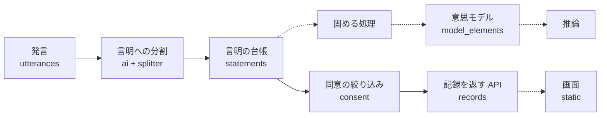

# 仕組みの説明

## 全体の流れ

話を聞くたびに整理して積み上げ、意思モデルを育てます。実線はいま動いている部分、点線はまだない部分です。

画面が使う API は、ログインと写真の問いだけで、記録の API はまだ呼びません。言明に分ける処理は API としてあり、画面からはまだ呼びません。

## 層の分け方

| 層 | ファイル | 中身 | AI を呼ぶか |
|---|---|---|---|
| 決まった手順 | `app/ledger.py` | 言明の台帳の追記と、連鎖の先頭の計算 | 呼ばない |
| 決まった手順 | `app/consent.py` | 同意の絞り込み | 呼ばない |
| 決まった手順 | `app/verbatim.py` | 本人の言葉の抜き出しの切り方の確かめ | 呼ばない |
| 決まった手順 | `app/splitter.py` | AI が分けた言明を確かめて保存する | 呼ばない |
| AI | `app/ai.py`、`app/prompts.py` | Claude API の呼び出し、結果の検証、プロンプト | 呼ぶ |
| 入口 | `app/auth.py`、`app/records.py` | 簡易ログインと、記録を返す API | 呼ばない |
| 入口 | `app/intake.py` | AI の層と決まった手順の層をつなぐ API | 呼ぶ |
| 土台 | `app/db.py`、`app/schemas.py`、`app/config.py` | 表、型、設定 | 呼ばない |

照合と絞り込みを AI の出来に左右させないため、層を分けています。分離は `tests/test_ai.py` で確かめています。

## 名前の対応

コード、docs、画面で同じものを同じ名前で呼ぶための表です。

| 日本語 | コードの名前 | 表の名前 |
|---|---|---|
| 発言 | `Utterance` | `utterances` |
| 言明（台帳） | `Statement`、`ledger` | `statements` |
| 解釈 | `Interpretation` | `interpretations` |
| 意思モデルの要素 | `ModelElement` | `model_elements` |
| 便り | `Letter` | `letters` |
| コメント | `Comment` | `comments` |
| 固める処理の記録 | `ConsolidationRun` | `consolidation_runs` |
| 推論の記録 | `InferenceLog` | `inference_logs` |
| 会話 | `Conversation` | `conversations` |
| 質問の記録 | `QuestionLog` | `question_logs` |
| 写真 | `Photo` | `photos` |
| ケアプラン原案 | `CarePlanDraft` | `care_plan_drafts` |
| 利用者 | `User` | `users` |
| 託す設定 | `Delegation` | `delegations` |
| 閲覧の記録 | `AccessLog` | `access_logs` |
| AI の呼び出しの記録 | `AICall` | `ai_calls` |
| 評価 | `Evaluation` | `evaluations` |
| 同意の絞り込み | `consent` | （表なし） |
| 共有範囲 | `ShareScope` | `share_scope` の列 |
| 出どころ | `Source` | `source` の列 |

いま処理があるのは、発言、言明、会話、便り、コメント、解釈、まだ聞いていない質問の追記（`ledger`）と、言明、便り、利用者の読み取り、託す設定の参照、閲覧の記録、AI の呼び出しの記録です。ほかの表は定義だけです。データの読み込みも `ledger` を通します。人生の地図、手帳、ツインの姿、視点別目次は保存せず、言明と意思モデルからその都度作る方針で、表を持ちません。

人物の名前と役割の値は、表の値としてそのまま日本語で持ちます。

## 言明の台帳の決まり

本人の言葉は作り直せないので、上書きしません。

- 表のトリガーが `UPDATE`、`DELETE`、`INSERT OR REPLACE` の上書きを拒否します。発言の表も同じです。
- 訂正は新しい行として追記し、`replaces_id` で元の行を指します。共有範囲は元の行から引き継ぎます。
- 1つの行を置き換えられるのは1回だけです。連鎖は一本道になります。
- いま有効な行は、だれからも置き換えられていない行です（`ledger.head_of`）。

出どころごとに、書ける話し手が決まっています。追記のときに `ledger` が確かめます。

| 出どころ | 書ける話し手 |
|---|---|
| 本人の言葉、本人の訂正 | 本人 |
| 今の様子（観察） | 専門職、家族（人が見て記録するものなので、ツインは書けない） |
| 家族の証言 | 家族 |
| 縁のある人の証言 | 縁のある人 |
| AIの推測 | ツイン |

確認の状態は、追記のときは「未確認」から始まります。「訂正済み」は訂正でだけ付きます。本人の訂正は、元の行を指す形でしか作れません。

状態の変化も追記で表します。確認済みとお休みの処理はまだありませんが、次の形で、本人だけが呼べる関数を `ledger` に置くと決めています。

| できごと | 新しい行の持ち方 |
|---|---|
| 訂正（処理あり） | 出どころ＝本人の訂正、確認の状態＝訂正済み、置き換えた言明＝元の行 |
| 確認（処理なし） | 元の行を写し、確認の状態＝確認済み、置き換えた言明＝元の行 |
| お休み（処理なし） | 元の行を写し、確認の状態＝お休み、置き換えた言明＝元の行 |

本人の言葉と本人の訂正は、追記のときに次のことを確かめます。

- 根拠の発言がちょうど1つである
- その発言を本人が話している
- 本文がその発言の原文に含まれ、文の切れ目で始まり終わる（`app/verbatim.py`）

関連するテスト：`tests/test_ledger.py`、`tests/test_verbatim.py`

## 言明に分ける処理

1. 発言に1始まりの番号を振り、人物の一覧と一緒に AI に渡す（`splitter.format_transcript`）。本当の番号は渡さない。
2. AI の答えを型で確かめ、合わなければ1回やり直す（`ai.call_structured`）。
3. 本人の言葉の本文に問題があれば、理由を伝えて1回やり直す（`intake.split_and_save`）。
4. 言明ごとに確かめて保存する（`splitter.save_split`）。合わない言明は捨てて、理由を数える。

プログラムが決めることは次のとおりです。

| 項目 | 決め方 |
|---|---|
| 共有範囲 | すべて「本人だけ」。AI から受け取らない |
| 確認の状態 | 未確認 |
| 解釈の状態 | 仮説 |
| 言明の根拠に本人の発言がないときの、本人の真意の確からしさ | 0.4 まで。決まった注意書きを必ず付ける |
| AIの推測の書き方 | すべての文が「〜かもしれません」などの言い切らない形でなければ捨てる |
| AIの推測の根拠 | 人の発言がなければ捨てる。解釈は付けない |
| 話した人 | 根拠の発言の話し手と同じでなければ捨てる（AIの推測を除く） |
| 本人に確かめる問いの候補 | 問いが1つで「合っていますか？」で終わるものだけ残す。「つらかったこと」は残さない |

1回の処理で Claude を呼ぶのは最悪4回です（型のやり直しが1回まで、本文のやり直しが1回まで）。通信の失敗の繰り返しを含めると、HTTP の要求は最悪12回です。

NAK の考え方をもとに、期間中に新しく書いた実装です。

| 仕組み | 目的 | この実装での使い方 |
|---|---|---|
| TSS | 話した人と、誰についての記録かを分ける | 言明の `speaker_user_id`、`speaker_is_twin` と `subject_user_id` |
| NAK-4V | 1つの言明を4つの視点で読む | `interpretations` の `perspective` |
| 仮説リーフ | 解釈を仮説として言明の下に並べる | `interpretations` の `statement_id` と `status` |
| 固定化警告 | 同じ見立てが確かめられないまま続くと印を付ける | 列の定義だけで、処理はまだない |
| 視点別目次 | 視点ごとの目次を作る | 処理はまだない |

関連するテスト：`tests/test_splitter.py`、`tests/test_intake.py`

## 見える範囲

絞り込みはサーバーの `app/consent.py` で行います。○が見える範囲です。

| 役割 | 本人だけ | 家族 | 縁のある人まで | 意思決定支援用 |
|---|---|---|---|---|
| 本人 | ○ | ○ | ○ | ○ |
| 家族（託す設定あり） | | ○ | ○ | ○ |
| 家族（託す設定なし） | | ○ | ○ | |
| 縁のある人 | | | ○ | |
| 専門職（招かれている） | | | | ○ |
| 専門職（招かれていない） | | | | |

- 本人は訂正の履歴も含めて開けます。本人以外が番号で開けるのは、連鎖の先頭の行だけです。
- 見せるかどうかは、先頭の行の共有範囲で決めます。
- 見えない行と先頭でない行を番号で開くと、存在しない番号と同じ 404 を返します。
- 応答には一覧だけを入れ、合計や件数の項目を持たせません。
- 花びらと根拠の発言の番号は、専門職の応答にだけ入れます。
- 置き換えた言明の番号は、本人の応答にだけ入れます。

関連するテスト：`tests/test_consent.py`

### 番号の持ち方

本人以外から隠れる行を持つ9つの表（言明、発言、会話、便り、コメント、写真、解釈、意思モデルの要素、推論の記録）は、番号を通し番号にしません。番号の飛びから、見えない行の数が分かるためです。

- 番号は 1〜2^53−1 の乱数です（`db.new_id`）。JavaScript で安全に扱える整数で、同じ番号が出たら作り直します。
- 列は `id INTEGER NOT NULL UNIQUE` です。指定し忘れると通し番号が付く形にせず、`NOT NULL` で止めます。
- 並び順に番号を使いません。時刻で並べ、同じ時刻の中では追記の順（応答に出ない `rowid`）で並べます。
- 番号は順番を表さないので、画面にそのまま見せません。

ほかの7つの表（利用者、託す設定、閲覧の記録、質問の記録、固める処理の記録、評価、ケアプラン原案）は通し番号のままです。本人以外に番号を出さないか、行が隠れないためです。

関連するテスト：`tests/test_ids.py`

### 分かっている限界

- 表に直接入れた行は、話し手と本人の言葉の確かめ（根拠の発言、原文の抜き出し）を通りません。この確かめは `app/ledger.py` にあるので、データの読み込みも `ledger` を通します。
- 固める処理の記録と推論の記録の、番号の配列の長さは、隠れた言明も数に入ります。どちらもまだ応答に出していません。本人以外に返すときは、見える行だけに絞ります。
- 写真のファイル名が連番だと、件数が読めます。写真を入れるときに、連番にしない名前にします。

### 共有範囲の列がない記録

次の記録を返す API はまだありません。作るときは次の決まりに従います。

| 記録 | 見える人 |
|---|---|
| 解釈 | 元の言明が見える人 |
| 意思モデルの要素 | 根拠の言明がすべて見える人 |
| 発言 | ぶら下がる会話か便りが見える人。日記の会話は本人だけ |

## 簡易ログイン

名前を選ぶと、番号を cookie で覚えます。パスワードはなく、本物の認証ではありません。そのためサーバーは `127.0.0.1` だけで待ち受けます。役割はブラウザから受け取らず、番号から毎回 `users` の表で引きます。

関連するテスト：`tests/test_api.py`
