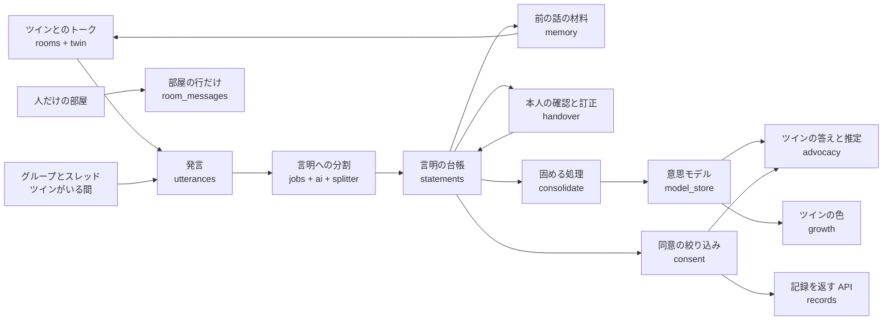
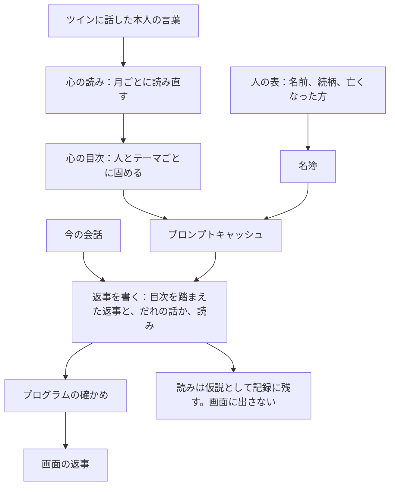
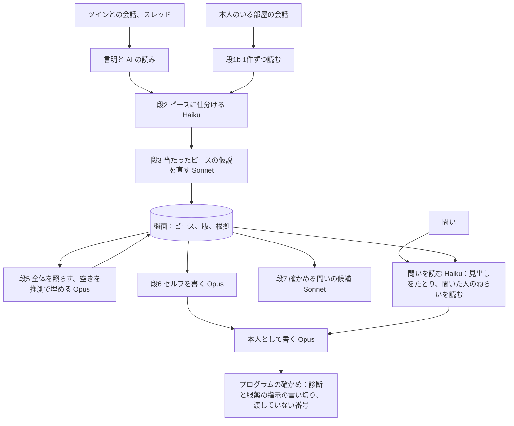

# 仕組みの説明

## 全体の流れ

話を聞くたびに整理して積み上げ、意思モデルを育てます。矢印は、いま動いている流れです。

人だけの部屋の発言は `utterances` に入らないので、言明になりません。本人のいる部屋は、架空データでだけ、セルフの読みの材料になります（下の「セルフ生成エンジン」）。本人のいない部屋は読みません。

## 層の分け方

| 層 | ファイル | 中身 | AI を呼ぶか |
|---|---|---|---|
| 決まった手順 | `app/ledger.py` | 言明の台帳の追記と、連鎖の先頭の計算 | 呼ばない |
| 決まった手順 | `app/consent.py` | 同意の絞り込み | 呼ばない |
| 決まった手順 | `app/verbatim.py` | 本人の言葉の抜き出しの切り方の確かめ | 呼ばない |
| 決まった手順 | `app/splitter.py` | AI が分けた言明を確かめて保存する。処理済みの印 | 呼ばない |
| 決まった手順 | `app/memory.py` | ツインが前の話を思い出すために読むものを、上限の中で集める | 呼ばない |
| 決まった手順 | `app/room_store.py` | 部屋、部屋の人、会話の区切り、部屋の発言の読み書き | 呼ばない |
| 決まった手順 | `app/images.py`、`app/photos.py` | 写真を整えて保存し、見てよい人にだけ返す | 呼ばない |
| 決まった手順 | `app/devlog.py` | 開発のログの書き出し。自分用のログには本文を通さない | 呼ばない |
| 決まった手順 | `app/model_store.py` | 意思モデルの要素の読み書き、見える範囲、読む量の上限 | 呼ばない |
| 決まった手順 | `app/growth.py` | 本人が確かめた根拠からツインの色を求める | 呼ばない |
| 決まった手順 | `app/handover.py`、`app/observations.py` | 本人の確認と訂正、託す設定、今の様子の入力 | 呼ばない |
| つなぐ | `app/consolidate.py` | 固める処理。AI の案の根拠を確かめて要素にする | 呼ぶ |
| つなぐ | `app/advocacy.py` | 専門職の問いに、選ばれた要素の根拠の本文を届ける | 呼ぶ |
| 決まった手順 | `app/medical.py` | 医療の決まり（原則17）の、AI への指示の文と、診断や服薬の指示の言い切りを見つける語の一覧 | 呼ばない |
| 決まった手順 | `app/twin_model.py` | 発言の中身を見て、必要なときだけ Sonnet 5.5 を選ぶ | 呼ばない |
| つなぐ | `app/advocacy_voice.py` | 意思モデルと読みをもとに、ツインが本人として主張する。補強に引く本人の言葉は番号で指す | 呼ぶ |
| つなぐ | `app/advocacy_letter.py` | 本人の今の暮らしと気持ちを、ツインが本人として書く手紙。本人か託された家族が読んで修正してから返す | 呼ぶ |
| つなぐ | `app/life_plan.py` | 生活まとめプランの下書き。専門職が画面で修正して紙で出す | 呼ぶ |
| つなぐ | `app/professional_records.py` | 専門職のチャットと資料（PDF）を読んで項目に分け、残すものだけを今の様子として台帳に入れる。取り込みの消去 | 呼ぶ |
| 入口 | `app/demo.py` | 固める処理のボタン、流した物語の起動 | 呼ぶ |
| 別の道具 | `fiction/` | 台本を流す道具、流した物語の読み込み、撮影の情報を消す道具、控えを取って戻す道具。架空用の起動の読み込みと控えだけが使い、自分用の起動では使わない | 呼ばれる |
| 比べの土台 | `eval/previous_story/` | 前の物語と、基本の RAG と比べた道具。アプリの動作には使わない | なし |
| AI | `app/ai.py`、`app/prompts.py` | Claude API の呼び出し、結果の検証、プロンプト | 呼ぶ |
| つなぐ | `app/twin.py` | ツインの答えをプログラムの決まりに通して発言にする | 呼ぶ |
| つなぐ | `app/intake.py`、`app/jobs.py` | 言明への分割の入口と、裏で動く処理 | 呼ぶ |
| 入口 | `app/rooms.py`、`app/timeline.py` | トークと、便りとタイムラインの API | 呼ぶ |
| 入口 | `app/auth.py`、`app/people.py`、`app/records.py`、`app/archive.py`、`app/ecomap.py` | 簡易ログイン、人の管理、記録、これまでの記録、地図と家系図の API | 呼ばない |
| 土台 | `app/db.py`、`app/schemas.py`、`app/config.py`、`app/clock.py` | 表、型、設定、今の時刻 | 呼ばない |

照合と絞り込みを AI の出来に左右させないため、層を分けています。分離は `tests/test_ai.py` で確かめています。

## 名前の対応

コード、docs、画面で同じものを同じ名前で呼ぶための表です。

| 日本語 | コードの名前 | 表の名前 |
|---|---|---|
| 心の読み、心の目次 | `heart`、`HeartReading` | `heart_readings` |
| ピース、根拠、セルフ | `selfhood`、`SelfhoodPiece`、`SelfhoodEvidence`、`SelfhoodDocument` | `selfhood_pieces`、`selfhood_evidence`、`selfhood_documents` |
| やり取りの読み | `DialogueReading` | `dialogue_readings` |
| 新規のデータ | `fresh`、`FreshApps` | データごとに別のファイル |
| 発言 | `Utterance` | `utterances` |
| 言明（台帳） | `Statement`、`ledger` | `statements` |
| 解釈 | `Interpretation` | `interpretations` |
| 意思モデルの要素 | `ModelElement` | `model_elements` |
| 便り | `Letter` | `letters` |
| コメント | `Comment` | `comments` |
| 固める処理の記録 | `ConsolidationRun` | `consolidation_runs` |
| 推論の記録 | `InferenceLog` | `inference_logs` |
| 会話 | `Conversation` | `conversations` |
| 質問の記録 | `QuestionLog` | `question_logs` |
| 写真 | `Photo` | `photos` |
| ケアプラン原案 | `CarePlanDraft` | `care_plan_drafts` |
| 利用者 | `User` | `users` |
| 託す設定 | `Delegation` | `delegations` |
| 閲覧の記録 | `AccessLog` | `access_logs` |
| AI の呼び出しの記録 | `AICall` | `ai_calls` |
| 評価 | `Evaluation` | `evaluations` |
| 部屋 | `Room` | `rooms` |
| 部屋の人 | `RoomMember` | `room_members` |
| 部屋の行（画面に出す行） | `RoomMessage` | `room_messages` |
| ツインが入っている間 | `TwinPresence` | `twin_presences` |
| 親子と夫婦の関係 | `FamilyLink` | `family_links` |
| 地図のつながり（人でない） | `MapPlace` | `map_places` |
| 地図の線 | `MapLink` | `map_links` |
| 話に出てきた人の候補 | `PersonCandidate` | `person_candidates` |
| どこまで分けたかの印 | `SplitMark` | `split_marks` |
| 裏の処理の記録 | `JobFailure` | `job_failures` |
| 同意の絞り込み | `consent` | （表なし） |
| 共有範囲 | `ShareScope` | `share_scope` の列 |
| 出どころ | `Source` | `source` の列 |

定義だけで処理がまだない表は、評価です。データの読み込みも `ledger` を通します。人生の地図、手帳、ツインの姿は保存せず、言明と意思モデルからその都度作る方針で、表を持ちません。

人物の名前と役割の値は、表の値としてそのまま日本語で持ちます。

## 言明の台帳の決まり

本人の言葉は作り直せないので、上書きしません。

- 表のトリガーが `UPDATE`、`DELETE`、`INSERT OR REPLACE` の上書きを拒否します。発言の表も同じです。
- 訂正は新しい行として追記し、`replaces_id` で元の行を指します。共有範囲は元の行から引き継ぎます。
- 1つの行を置き換えられるのは1回だけです。連鎖は一本道になります。
- いま有効な行は、だれからも置き換えられていない行です（`ledger.head_of`）。

出どころごとに、書ける話し手が決まっています。追記のときに `ledger` が確かめます。

| 出どころ | 書ける話し手 |
|---|---|
| 本人の言葉、本人の訂正 | 本人 |
| 今の様子（観察） | 専門職、家族（人が見て記録するものなので、ツインは書けない） |
| 家族の証言 | 家族 |
| 縁のある人の証言 | 縁のある人 |
| AIの推測 | ツイン |

確認の状態は、追記のときは「未確認」から始まります。「訂正済み」は訂正でだけ付きます。本人の訂正は、元の行を指す形でしか作れません。

状態の変化も追記で表します。本人だけが呼べる関数を `ledger` に置いています。

| できごと | 新しい行の持ち方 | 関数 |
|---|---|---|
| 訂正 | 出どころ＝本人の訂正、確認の状態＝訂正済み、置き換えた言明＝元の行 | `correct_statement` |
| 確認 | 元の行を写し、確認の状態＝確認済み、置き換えた言明＝元の行 | `confirm_statement` |
| お休み | 元の行を写し、確認の状態＝お休み、範囲＝本人だけ、置き換えた言明＝元の行 | `rest_statement` |
| 範囲の変更 | 元の行を写し、範囲を変える。置き換えた言明＝元の行 | `change_share_scope` |

行の時刻は引数で受け取れます。架空ログの読み込みで物語の日付を入れ、ツインの色の移り変わりを保つためです。

本人の言葉と本人の訂正は、追記のときに次のことを確かめます。

- 根拠の発言がちょうど1つである
- その発言を本人が話している
- 本文がその発言の原文に含まれ、文の切れ目で始まり終わる（`app/verbatim.py`）

関連するテスト：`tests/test_ledger.py`、`tests/test_verbatim.py`

## ツインとのトーク

1. 本人の発言を `ledger` を通して保存する。問いは質問の記録に入れる。
2. 前の話の材料を上限の中で集める（`memory.build_twin_context`）。今の会話、過去の会話の要約、前に聞いた本人の言葉、聞いた問い、確かめる問いの候補、お休みの話題。
3. Claude に返事を頼み、受け止めと問いを別の項目で受け取る（`schemas.TwinTurn`）。
4. プログラムの決まりに通して保存する（`twin.respond_in_twin_room`）。

プログラムが決めることは次のとおりです。

| 項目 | 決め方 |
|---|---|
| 問いの数 | 1回に1つまで。受け止めの文に問いの形があれば型で止めて、やり直す |
| 問いの間隔 | 問いが2回続いたら、次は受け止めるだけにする |
| 聞かない問い | お休みのテーマ、つらかったことのテーマ、健康と亡くなった人の語を含む問い、同じ問いとよく似た問いは落とす |
| 本人が終えたそうなとき | 問いを落とす |
| 本人になりきる文 | 本人との会話では「私は」などがあれば型で止めて、やり直す。専門職への代弁では止めない（原則9） |
| 体の急な不調、命に関わる言葉、強いつらさ | 語の一覧を AI の判定に重ねる。問いを落とし、つなぎ先の文をプログラムが添える。AI が断っても、つなぎ先を返す |

会話の区切りと裏の処理は次のとおりです。

- 「今日はここまで」で会話を閉じる。送ったときに開いている会話の日付が今日でなければ、先に閉じる。
- 閉じたあと、裏で言明への分割、要約、人の候補を流す（`jobs.after_close`）。本人を待たせない。
- 途中で止まっても、`python -m app` の起動のときに未処理を流し直す（`jobs.catch_up`）。
- 裏の処理の失敗と、入らなかった言明の理由は `job_failures` に残す。本文は残さない。

問いの選び方と前の話の覚え方は、固める処理ができるまでの仮の形です（[decisions.md](decisions.md)）。

関連するテスト：`tests/test_twin.py`

## ツインとの会話エンジン

本人の言葉を月ごとに読み直して心の目次に固め、返事のたびに丸ごと渡します（`app/heart.py`）。返事は1回の呼び出しで書きます（`app/twin.py` の `respond_in_twin_room`）。

| 段 | Claude が担うこと | プログラムが確かめること |
|---|---|---|
| 心の読み | その人や事柄が本人にとって何か、どう受け止めるとよいかを読む | 渡した番号だけを根拠にする。根拠のない読みは入れない |
| 心の目次 | 月の読みを人とテーマごとに固める | 渡した番号だけを本人の言葉として並べる。本文は記録のまま |
| 返事 | 目次を踏まえて、言い直しでない言葉を書く。だれの話か、否定的な話かも同じ答えに書く | 下の表 |

返事でプログラムが止めるものは次のとおりです。

| 止めるもの | 理由 |
|---|---|
| 本人が言っていないのに「亡くなった」と書いた文 | 亡くなったことを、こちらから言わず、訂正もしない |
| 亡くなった方と何かをする案 | 実際に夕飯を勧める一言が出た。「一緒に」は勧める形（〜のもいい、〜ませんか など）のときだけ数え、「一緒に過ごした年月」は止めない |
| 記録にないかぎかっこの文 | 人の言葉に見える。記録にない言葉を人の言葉として出さない（原則9） |
| かぎかっこなしで本人の言葉として伝える文 | 言い換えた文が本人の言葉として届く（原則9） |
| 作業の言葉の文 | 実際に「〜は言い直しになるので」と書いた返事が出た |
| 「まだ聞けていません」「分かりません」など、言い切る文 | 本人には冷たく聞こえる。専門職の問いの決まった文には使わない |
| 亡くなった方の話の問い | 返事の「だれの話か」に名簿の亡くなった方が入っていたら、問いを書いても出さない（原則6） |
| 否定的な話に同意する文 | 返事が否定的な話と答えたとき、寄り添っても同意しない。「そうですね」「確かに」などで始まる文を落とす |

止めるのは文ごとで、ほかの受け止めの文は残します。全部の文が落ちたときは、亡くなった方の話なら「そうなんですね。話してくださって、ありがとうございます。」を、ふだんの話なら「そうでしたか。」を返します。重い話に「そうでしたか。」とだけ返すと、冷たく聞こえたためです（tyumajinさんの指摘）。関連するテスト：`tests/test_heart.py` の `test_亡くなった方の話で返事が全部落ちたら_寄り添う受け止めを返す`。

守っていることは次のとおりです。

- 材料はツインに話した本人の言葉だけです。人だけの部屋は発言の表に入らないので、材料に入りません（原則15）。証言と AI の推測も入れません。
- 読みは `heart_readings` にだけ持ち、API では返しません。専門職と家族の画面の処理はこの表を読みません。
- 読みは追記だけです。作り直すときは新しい版を足します。言明は変えず、どのモデルで作ったかを行ごとに残します。
- 問いのたびに似た文を探しません。返事は目次を丸ごと読み、読む量は上限（16,000字）までです。
- 会話を閉じると、その月を読み直して「ここ最近の読み」に足します。目次に固め直すのは `python -m fiction.heart_reread` です。

関連するテスト：`tests/test_heart.py`

## 人どうしの部屋と、グループのツイン

| 部屋 | 作れる人 | 本文の置き場 | AI |
|---|---|---|---|
| ツインとの部屋 | 本人に1つ | `utterances` | 読む |
| 1対1 | だれでも | `room_messages` | 読まない |
| グループ（ツインなし） | だれでも | `room_messages` | 読まない |
| グループ（ツインがいる間） | 部屋にいる本人と、立場が家族の託された人が出し入れする。本人がいる部屋だけ | `utterances` | その会話の発言だけ読む |

会話と代弁の処理は `utterances` しか読みません（例外はセルフの段1b で、読みの表に置き、言明にせず、引きません）。人だけの部屋の発言とツインが入る前の発言は `room_messages` にだけあるので、表の形で AI に渡りません。グループにツインが入るたびに会話を1行作るので、前に入っていた間の発言も渡りません。

グループのツインが書くのは2つの場面だけです（`twin.group_turn`）。

- 家族や知人の発言のあとに、本人への問いを1つ書く。本人が答えるまで次の問いを書かない。
- 「@ツイン」で呼ばれたら、部屋に見えている内容の範囲で短く答える。本人の考えや気持ちを聞かれたら、AI を呼ばずに「ここでは聞けていません。ご本人にうかがってください。」と返す。

関連するテスト：`tests/test_rooms.py`

## 便りとタイムライン

会話のあとで AI が下書き（120字以内）を作ります（保存しません）。本人が直し、相手を選んで「この内容で共有する」を押すと、タイムラインに出ます。コメントは発言としても保存し、役割に合わせた証言として言明に分けます。本人の答えは本人の言葉になります。言明の共有範囲は「本人だけ」のままで、便りの相手とは別のことです。

スレッドのツインに渡すのは、その便りとコメントだけです（`twin.thread_turn`）。

関連するテスト：`tests/test_timeline.py`

## PC版とスマホ版

`static/device.js`。`document.body.dataset.device` を `pc` か `phone` にします。はじめは幅900pxで決め、押したら覚えます。スマホ版を広い画面で開くと、幅390pxで中央に置きます。PC版のトークは、一覧、部屋、この部屋のこと（`static/room_info.js`）の3ペインです。理由は `docs/decisions.md` にあります。

## ケア会議の画面

`static/meeting.js`。3人が同じ画面を見るので、開けるのは専門職だけです。答えは `POST /api/advocacy/ask` で作り、「ツインに聞く」と同じ処理を通ります。画面は、サーバーが返した前置きと記録の本文だけを字幕に出し、読み上げます（`static/speech.js`）。推定は別の枠のままで、読み上げません。今の様子は `POST /api/observations` に `at_meeting` を付けて入れ、発言の場所を「会議」にします（`tests/test_meeting.py`）。

## 写真

- 画面で長い辺を1568pxほどに縮めて送り、サーバーでも開き直して JPEG にし、撮影の情報を落とす（`images.normalize`）。
- 乱数の名前で保存し、静的ファイルとしては出さない。`GET /api/photos/{番号}` だけで中身を返す。
- 人の写真の枠は2つある。丸く出すアイコン（`users.photo_id`）と、大きく出すプロフィール写真（`users.profile_photo_id`）。写真の行は枠ごとに分け、別々に入れ替えられる。
- 見てよいかは参照元から毎回求める（`photos.can_see_photo`）。持ち主、その写真を指す部屋の人、その写真を指す便りの共有範囲の人、はずされていない人のアイコンとプロフィール写真。
- ログインなしで読めるのは入口の顔だけ（`photos.is_entrance_face`）。架空用の起動で、種類がプロフィールで、入口に名前が出る人のアイコンに限る。プロフィール写真は読めない。自分用の起動では入口は頭文字のままにする。
- AI に送る関数は「会話」の写真だけを受け付ける（`ai.twin_photo_turn`）。アイコンとプロフィール写真は送らない。
- デモの顔は、架空用の起動の空いた枠にだけ入れる（`fiction/faces.py`）。入れ方は `data/README.md` にある。
- 写真の説明（AI の読み取り）は `photos.description` に残し、あとの会話で「[写真：説明]」として渡す。

関連するテスト：`tests/test_photos.py`、`tests/test_profile_photo.py`

## 表の変更

本人の記録は作り直せないので、追記だけの表を作り直しません。

- 決めた言葉の確かめは CHECK ではなくトリガーで行う。起動のたびに作り直すので、言葉を足すだけで効く。
- 列を足すときは `db.MIGRATIONS` に追加だけの手順を書く。適用の前にファイルを隣に控える（`.before_v番号`）。
- 古い形のデータベースは起動を止めて知らせる。

関連するテスト：`tests/test_schema.py`

## 言明に分ける処理

1. 印より後の発言に1始まりの番号を振り、人物の一覧と一緒に AI に渡す（`splitter.format_transcript`）。本当の番号は渡さない。印より前の発言は文脈として番号なしで渡す。人物の一覧には、本人、話した人、発言に名前が出てくる人だけを入れる。
2. AI の答えを型で確かめ、合わなければ1回やり直す（`ai.call_structured`）。
3. 本人の言葉の本文に問題があれば、理由を伝えて1回やり直す（`intake.split_and_save`）。
4. 言明ごとに確かめて保存する（`splitter.save_split`）。合わない言明は捨てて、理由を数える。全部入るか全部入らないかの1つの処理で、どこまで分けたかの印も同じ処理で進める。

プログラムが決めることは次のとおりです。

| 項目 | 決め方 |
|---|---|
| 共有範囲 | すべて「本人だけ」。AI から受け取らない |
| 確認の状態 | 未確認 |
| 解釈の状態 | 仮説 |
| 言明の根拠に本人の発言がないときの、AI の読みの確からしさ | 0.4 まで。決まった注意書きを必ず付ける |
| AIの推測の書き方 | すべての文が「〜かもしれません」などの言い切らない形でなければ捨てる |
| AIの推測の根拠 | 人の発言がなければ捨てる。解釈は付けない |
| 話した人 | 根拠の発言の話し手と同じでなければ捨てる（AIの推測を除く） |
| 本人に確かめる問いの候補 | 問いが1つで「合っていますか？」で終わるものだけ残す。「つらかったこと」は残さない |

1回の処理で Claude を呼ぶのは最悪4回です（型のやり直しが1回まで、本文のやり直しが1回まで）。通信の失敗の繰り返しを含めると、HTTP の要求は最悪12回です。重い言葉の分割で Sonnet 5.5 が答えられず Haiku 5.5 へ切り替えると、最悪6回、通信の繰り返しを含めて最悪18回になります（`docs/tools.md`）。

記録の出どころと読みは、次のように持ちます。

| 決まり | 目的 | この実装での使い方 |
|---|---|---|
| 話した人と誰の話かを分ける | 家族の言葉を本人の意思と取り違えない | 言明の `speaker_user_id`、`speaker_is_twin` と `subject_user_id` |
| AI の読みは仮説 | 言明ごとに「この言葉から分かる本人の考え」を1つ、仮説として持つ。本人が確かめると状態が変わる | `interpretations` の `statement_id`、`body`、`status` |
| 確かめられないまま続く読み | 同じ見立てが本人に確かめられないまま続いたら印を付けるための材料 | 固める処理の流し直しで `unconfirmed_reconsolidations` を数える。印の表示はまだない |

関連するテスト：`tests/test_splitter.py`、`tests/test_intake.py`

## 固める処理と意思モデル

言明を月、年、人生の段階の順にまとめます（`app/consolidate.py`）。

1. 月：その月のいま有効な言明に番号を振って渡し、要素の案を受け取る。今の様子とお休みは入れない。
2. 年：月の要素に番号を振って渡す。人生の段階：年の要素に番号を振って渡す。
3. 根拠の番号をプログラムが確かめる。渡していない番号は捨て、根拠のない要素は入れない。年と段階の根拠は、選んだ下の段の要素の根拠の和集合にする。
4. 根拠は訂正の連鎖のいちばん元の行の番号で持つ。読むときに先頭の行へたどる。

| 項目 | 決め方 |
|---|---|
| 変化 | 今の要素と食い違うときは上書きせず、種類を変化にして前の要素を指す。元の要素は閉じない。確かめる問いの候補を1つ入れる |
| 同じ期間を流し直す | 続く要素は版を1つ進めて前の版を指す。続かない要素は閉じる。行は残す |
| 同じ入力 | 入力の言明の番号が前回と同じなら AI を呼ばない |
| 要素の状態 | 根拠の先頭の行に本人が確かめた行があれば本人確認済み。読むたびに根拠から求める |
| 読む量 | 人生の段階、新しい年、新しい月の順に、12,000字まで（`model_store.for_reading`） |

要素が見えるのは、根拠の先頭の行がすべて見えるときだけです。隠れた根拠があると、要素の本文から「本人だけ」の中身が漏れるためです。

関連するテスト：`tests/test_consolidate.py`

## 田中さんとツインのチャット

`app/advocacy.py` が、1回の問いを次の順に処理します。

1. 要素を選ぶ（役割：ツインの答え）。見える要素を読む量の上限の中で番号つきで並べ、AI が問いに直接答える要素と、関係はあるが直接は答えない要素の番号を選ぶ。頼みの種類も見分ける。本人の言葉の本文は渡さない。意思モデルのブロックをプロンプトキャッシュに載せる。
2. 言葉を選ぶ（役割：言葉を選ぶ）。選ばれた要素の根拠から、本人の言葉を上限30件、証言と AI の推測を上限12件、番号つきで渡す。証言と推測は根拠にある分を先に、足りない分を新しい順で埋める。AI は問いの事柄そのものを語っている言葉の番号を枠ごとに選ぶ。
3. プログラムが、番号が候補にあり、出どころが枠に合うものだけを通す。本文は記録のままで、前置きはプログラムが付ける。失敗したら、要素の根拠から順に取り出す道へ落とす。
4. 今の様子、本人の言葉、証言、AIの推測の順に並べる（`records.order_for_display`）。
5. 本人の言葉がなければ「まだ聞けていません。」を決まった文で出し、質問の記録に残し、役割「推定意思」の AI で推定を別の枠に作る。

AI の出力から本人の言葉が作られる道はありません。受け取るのは番号と短い案内だけです。推定の枠は、言い切りと、記録の有無の言い切りと、渡していない番号の根拠を通しません。

読むのは意思モデルなので、意思モデルの根拠に入らない言葉には届きません。範囲内の本人の言葉1,313件のうち365件がこれにあたります。「物忘れについて、どう話していましたか」のように、出来事の言葉は要素の根拠に入らないことがあります。

原則に触れる頼みは、語の一覧を AI の判定に重ね、決まった1文を添えます。断って終わりにせず、通常の処理も流します。

関連するテスト：`tests/test_advocacy.py`

## ツインの色

本人が確かめた根拠を持つ要素の花びらを数え、濃さの言葉にします（`app/growth.py`）。保存しません。確かめた行は追記だけで消えないので、色は減りません。数と花びらの名前は返しません。

関連するテスト：`tests/test_growth.py`

### 5つの花びらの読み

5枚の花びらは、パーソン・センタード・ケアの考え方で、その人らしさ（パーソンフッド）を保つために満たされるべきとされる、トム・キットウッドの5つの心理的ニーズです（くつろぎ、結びつき、共にあること、たずさわること、自分らしさ。`app/schemas.py` の `Petal`）。

`GET /api/twin/petals`（`app/petals.py`）は、花びらごとに「何で満たされるか」「何で損なわれるか」「今どうか」の3つの面について、セルフの盤面に保存した読み（仮説）と、根拠の本人の言葉（本人の言葉と本人の訂正の本文のまま、新しい順に2つまで）を返します。AI は呼びません。根拠の言葉と、読みの中のかぎかっこの引用は、見る人に見える記録で確かめたものだけを残します。返すのは本人と託された専門職で、家族と縁のある人には 404 です。確からしさの数は返しません。

関連するテスト：`tests/test_petals.py`

## 流した物語の読み込みと、控え

台本（`data/select/script_YYYY.jsonl`）を `fiction/run_script.py` で本物の AI に流し、節目の控えを表ごとの JSON（`data/select/tables/`）に書き出しました。新しいクローンの最初の起動で `fiction/story_data.py` が読み込みます。AI は呼びません。番号は流したときのままです。要素の根拠と、保存したツインの考えが言明を番号で指しているためです。

流したあとで決まった直しは `fiction/story_fixes.py` で当てました。内容は `data/README.md` にあります。

日付は記録から決まります（最後に固めた日の翌日）。最初の起動で決めた日を `story_marks` に残すので、起動し直しても動きません。場面は、データベースと写真の控えから開き直します（`fiction/snapshot.py`）。

関連するテスト：`tests/test_story_data.py`、`tests/test_story_fixes.py`、`tests/test_demo.py`、`tests/test_snapshot.py`

## 見える範囲

絞り込みはサーバーの `app/consent.py` で行います。○が見える範囲です。

| 役割 | 本人だけ | 家族 | 縁のある人まで | 意思決定支援用 |
|---|---|---|---|---|
| 本人 | ○ | ○ | ○ | ○ |
| 家族（託す設定あり） | | ○ | ○ | ○ |
| 家族（託す設定なし） | | ○ | ○ | |
| 縁のある人 | | | ○ | |
| 専門職（招かれている） | | | | ○ |
| 専門職（招かれていない） | | | | |

- 本人は訂正の履歴も含めて開けます。本人以外が番号で開けるのは、連鎖の先頭の行だけです。
- 見せるかどうかは、先頭の行の共有範囲で決めます。
- 見えない行と先頭でない行を番号で開くと、存在しない番号と同じ 404 を返します。
- 応答には一覧だけを入れ、合計や件数の項目を持たせません。
- 花びらと根拠の発言の番号は、専門職の応答にだけ入れます。
- 花びらごとの読み（`GET /api/twin/petals`、`app/petals.py`）も専門職にだけ返します。セルフの「A 花びら」の15か所（5つの花びら×満たされる・損なわれる・今）に保存した読みをそのまま返し、根拠の本人の言葉は、見る人の「記録」の一覧に出る言明だけから本文のまま添えます。確からしさの数は返しません。専門職の「記録」の上で、3Dのツインのまわりのボタンから読みます。関連するテスト：`tests/test_petals.py`
- 置き換えた言明の番号は、本人の応答にだけ入れます。

関連するテスト：`tests/test_consent.py`

### 番号の持ち方

本人以外から隠れる行を持つ11の表（言明、発言、会話、便り、コメント、写真、解釈、意思モデルの要素、推論の記録、部屋、部屋の行）は、番号を通し番号にしません。新しく登録した人の番号も乱数にします。番号の飛びから、見えない行の数が分かるためです。

- 番号は 1〜2^53−1 の乱数です（`db.new_id`）。JavaScript で安全に扱える整数で、同じ番号が出たら作り直します。
- 列は `id INTEGER NOT NULL UNIQUE` です。指定し忘れると通し番号が付く形にせず、`NOT NULL` で止めます。
- 並び順に番号を使いません。時刻で並べ、同じ時刻の中では追記の順（応答に出ない `rowid`）で並べます。
- 番号は順番を表さないので、画面にそのまま見せません。

ほかの表（託す設定、閲覧の記録、質問の記録、固める処理の記録、評価、ケアプラン原案など）は通し番号のままです。本人以外に番号を出さないか、行が隠れないためです。

関連するテスト：`tests/test_ids.py`

### 分かっている限界

- 表に直接入れた行は、話し手と本人の言葉の確かめ（根拠の発言、原文の抜き出し）を通りません。この確かめは `app/ledger.py` にあるので、データの読み込みも `ledger` を通します。
- 固める処理の記録と推論の記録の、番号の配列の長さは、隠れた言明も数に入ります。どちらもまだ応答に出していません。本人以外に返すときは、見える行だけに絞ります。

### 共有範囲の列がない記録

次の記録を返す API はまだありません。作るときは次の決まりに従います。

| 記録 | 見える人 |
|---|---|
| 解釈 | 元の言明が見える人 |
| 意思モデルの要素 | 根拠の言明がすべて見える人 |
| 発言 | ぶら下がる会話か便りが見える人。日記の会話は本人だけ |

### ツインにだけ話した言葉

本人がツインに話した言葉は、本人以外の一覧、番号で開く API、根拠をたどる API から、サーバーで外します（`consent.listable_statements`、`only_to_twin_ids`）。託すとほぼ全部が開くためです。AI の材料には使い、代弁に欠かせないときだけ引きます。引いた言葉だけが、代弁の中で本文のまま見えます。

関連するテスト：`tests/test_only_to_twin.py`

## セルフ生成エンジン

記録を読んで、本人の人物像を盤面として組み上げます。言葉の読みはすべて仮説として本人の言葉と分けて持ち、次の言葉で確かめて直します。

基本的な RAG は、問いが来てから探します。このエンジンは、問いが来る前に本人を組み上げておきます。ツインは本人の人間性に近づき、専門職に聞かれたら本人として代弁します。本人には今までどおり「誠一さん」と呼びかけ、姿と声は似せません。

| 決まり | 内容 |
|---|---|
| 確からしさ | (支え + 1) / (支え + 反証 + 2)。プログラムが計算する。AI に決めさせない |
| 根拠の重み | 本人が確かめた 4、本人の言葉 2、本人のいる部屋の会話 2、今の様子 2、証言 1、推測 0.5、足された受け答え 0.5、本人の訂正 4（反証） |
| 古い根拠 | 3年で重みが半分。5年以上にわたって支えが続くピースは減らさない |
| 話した人と対象 | 本人以外の発言は、関係のピースと今のずれにだけ当てる。本人の気持ちに数えない |
| 読まないもの | 本人のいない部屋、本人だけ、お休み、AI の推測 |
| 引かないもの | 本人のいる部屋の会話の本文。読みの表（`dialogue_readings`）に読みだけを置く |
| 追記だけ | `selfhood_pieces`、`selfhood_evidence`、`selfhood_documents`、`dialogue_readings`。直すたびに版を足す。今ある言明と解釈の表は変えない |
| 実データ | 開かない（`selfhood.refuse_real_records`）。人だけの部屋を読むと相手の言葉も API に送られ、取り消せないため。実際に使うには相手の同意が要る |
| 型や点数 | 作らない。ピースはその人の物語を文で書く |

提出用には、10年分を古い順に再生します（`fiction/selfhood_replay.py`）。ある日付の盤面は、その日までの版と根拠から引くので、切り口ごとに再生し直しません。

答え合わせは `eval/selfhood_check.py` です。結果は `docs/verification/selfhood/` に残します。

関連するテスト：`tests/test_selfhood.py`、`tests/test_selfhood_voice.py`、`tests/test_selfhood_check.py`

## 簡易ログイン

名前を押すと、画面がその人の番号をウィンドウごとに覚え、ヘッダー `X-NT-User` で送ります。cookie は同じブラウザのウィンドウで共有されるので、2つのウィンドウで別の人として使えないため使いません。パスワードはなく、本物の認証ではありません。そのためサーバーは `127.0.0.1` だけで待ち受けます。役割はブラウザから受け取らず、番号から毎回 `users` の表で引きます。はずした人と亡くなった方はログインできません。

関連するテスト：`tests/test_api.py`、`tests/test_people.py`

## 架空用と自分用の起動

| 起動 | ポート | データ | 画面の隅 |
|---|---|---|---|
| `python -m app` | 8000 | `data/narrative_twin.db`、`data/photos/` | 架空データ |
| `python -m app` の入口の「新規で始める」 | 8000 | `data/fresh/<番号>/` | 新規のデータ |
| `python -m app --mine` | 8001 | `data/mine/` | 自分の記録で試用中 |

開発者が自分の記録で試すときは手元だけに置きます。`data/mine/` と `data/photos/` は Git に入りません。ブラウザを操作する道具が開けるのは架空用のポートだけです（`.mcp.json`）。

関連するテスト：`tests/test_modes.py`

### 新規のデータ

1つのデータに本人は1人で、動いているサーバーの下でファイルを入れ替えません。そこで `app/fresh.py` が、新規ごとに `create_app` で別のアプリを作り、ヘッダー `X-NT-Data` の値で要求ごとに振り分けます。

- 鍵、考え中の部屋、日付のずれはアプリごとに持つので、デモと新規は混ざりません。2つのウィンドウで別のデータを同時に使えます。
- 動きの決まりは自分用の起動と同じです（`mine=True`）。架空の人を入れず、日付を動かさず、ログに本文を書かず、入口に顔を出しません。新規には実在の人の話が入りうるためです。保存先とログだけが違います。
- 振り分けはいちばん外に置きます。デモのログには本文が書かれることがあるので、新規の要求を通さないためです。
- 止まった処理は、`python -m app` の起動のあとで、その新規を最初に開いたときに流し直します。
- 自分用の起動には、振り分けも `/api/fresh` もありません。新規のアプリにも付かないので、入れ子になりません。

関連するテスト：`tests/test_fresh.py`
