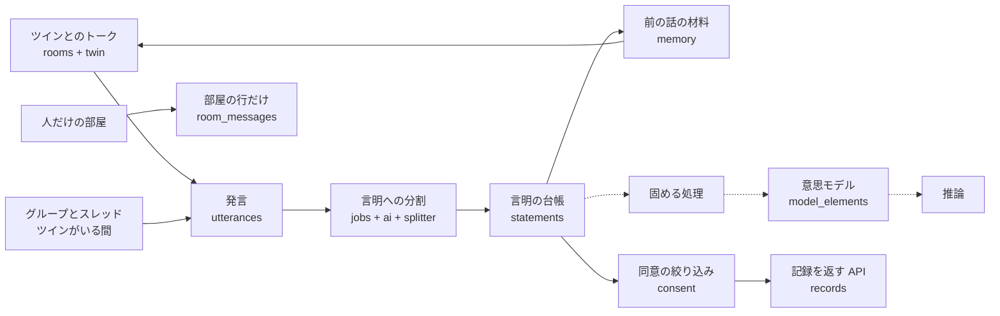

# 仕組みの説明

## 全体の流れ

話を聞くたびに整理して積み上げ、意思モデルを育てます。実線はいま動いている部分、点線はまだない部分です。

人だけの部屋の発言は `utterances` に入らないので、言明にも AI にも渡りません。言明はまだ画面に出していません（今日うかがったことの確認の画面はこれから作ります）。

## 層の分け方

| 層 | ファイル | 中身 | AI を呼ぶか |
|---|---|---|---|
| 決まった手順 | `app/ledger.py` | 言明の台帳の追記と、連鎖の先頭の計算 | 呼ばない |
| 決まった手順 | `app/consent.py` | 同意の絞り込み | 呼ばない |
| 決まった手順 | `app/verbatim.py` | 本人の言葉の抜き出しの切り方の確かめ | 呼ばない |
| 決まった手順 | `app/splitter.py` | AI が分けた言明を確かめて保存する。処理済みの印 | 呼ばない |
| 決まった手順 | `app/memory.py` | ツインが前の話を思い出すために読むものを、上限の中で集める | 呼ばない |
| 決まった手順 | `app/room_store.py` | 部屋、部屋の人、会話の区切り、部屋の発言の読み書き | 呼ばない |
| 決まった手順 | `app/images.py`、`app/photos.py` | 写真を整えて保存し、見てよい人にだけ返す | 呼ばない |
| AI | `app/ai.py`、`app/prompts.py` | Claude API の呼び出し、結果の検証、プロンプト | 呼ぶ |
| つなぐ | `app/twin.py` | ツインの答えをプログラムの決まりに通して発言にする | 呼ぶ |
| つなぐ | `app/intake.py`、`app/jobs.py` | 言明への分割の入口と、裏で動く処理 | 呼ぶ |
| 入口 | `app/rooms.py`、`app/timeline.py` | トークと、便りとタイムラインの API | 呼ぶ |
| 入口 | `app/auth.py`、`app/people.py`、`app/records.py`、`app/archive.py`、`app/ecomap.py` | 簡易ログイン、人の管理、記録、これまでの記録、地図と家系図の API | 呼ばない |
| 土台 | `app/db.py`、`app/schemas.py`、`app/config.py`、`app/clock.py` | 表、型、設定、今の時刻 | 呼ばない |

照合と絞り込みを AI の出来に左右させないため、層を分けています。分離は `tests/test_ai.py` で確かめています。

## 名前の対応

コード、docs、画面で同じものを同じ名前で呼ぶための表です。

| 日本語 | コードの名前 | 表の名前 |
|---|---|---|
| 発言 | `Utterance` | `utterances` |
| 言明（台帳） | `Statement`、`ledger` | `statements` |
| 解釈 | `Interpretation` | `interpretations` |
| 意思モデルの要素 | `ModelElement` | `model_elements` |
| 便り | `Letter` | `letters` |
| コメント | `Comment` | `comments` |
| 固める処理の記録 | `ConsolidationRun` | `consolidation_runs` |
| 推論の記録 | `InferenceLog` | `inference_logs` |
| 会話 | `Conversation` | `conversations` |
| 質問の記録 | `QuestionLog` | `question_logs` |
| 写真 | `Photo` | `photos` |
| ケアプラン原案 | `CarePlanDraft` | `care_plan_drafts` |
| 利用者 | `User` | `users` |
| 託す設定 | `Delegation` | `delegations` |
| 閲覧の記録 | `AccessLog` | `access_logs` |
| AI の呼び出しの記録 | `AICall` | `ai_calls` |
| 評価 | `Evaluation` | `evaluations` |
| 部屋 | `Room` | `rooms` |
| 部屋の人 | `RoomMember` | `room_members` |
| 部屋の行（画面に出す行） | `RoomMessage` | `room_messages` |
| ツインが入っている間 | `TwinPresence` | `twin_presences` |
| 親子と夫婦の関係 | `FamilyLink` | `family_links` |
| 地図のつながり（人でない） | `MapPlace` | `map_places` |
| 地図の線 | `MapLink` | `map_links` |
| 話に出てきた人の候補 | `PersonCandidate` | `person_candidates` |
| どこまで分けたかの印 | `SplitMark` | `split_marks` |
| 裏の処理の記録 | `JobFailure` | `job_failures` |
| 同意の絞り込み | `consent` | （表なし） |
| 共有範囲 | `ShareScope` | `share_scope` の列 |
| 出どころ | `Source` | `source` の列 |

定義だけで処理がまだない表は、意思モデルの要素、固める処理の記録、推論の記録、ケアプラン原案、評価です。データの読み込みも `ledger` を通します。人生の地図、手帳、ツインの姿、視点別目次は保存せず、言明と意思モデルからその都度作る方針で、表を持ちません。

人物の名前と役割の値は、表の値としてそのまま日本語で持ちます。

## 言明の台帳の決まり

本人の言葉は作り直せないので、上書きしません。

- 表のトリガーが `UPDATE`、`DELETE`、`INSERT OR REPLACE` の上書きを拒否します。発言の表も同じです。
- 訂正は新しい行として追記し、`replaces_id` で元の行を指します。共有範囲は元の行から引き継ぎます。
- 1つの行を置き換えられるのは1回だけです。連鎖は一本道になります。
- いま有効な行は、だれからも置き換えられていない行です（`ledger.head_of`）。

出どころごとに、書ける話し手が決まっています。追記のときに `ledger` が確かめます。

| 出どころ | 書ける話し手 |
|---|---|
| 本人の言葉、本人の訂正 | 本人 |
| 今の様子（観察） | 専門職、家族（人が見て記録するものなので、ツインは書けない） |
| 家族の証言 | 家族 |
| 縁のある人の証言 | 縁のある人 |
| AIの推測 | ツイン |

確認の状態は、追記のときは「未確認」から始まります。「訂正済み」は訂正でだけ付きます。本人の訂正は、元の行を指す形でしか作れません。

状態の変化も追記で表します。確認済みとお休みの処理はまだありませんが、次の形で、本人だけが呼べる関数を `ledger` に置くと決めています。

| できごと | 新しい行の持ち方 |
|---|---|
| 訂正（処理あり） | 出どころ＝本人の訂正、確認の状態＝訂正済み、置き換えた言明＝元の行 |
| 確認（処理なし） | 元の行を写し、確認の状態＝確認済み、置き換えた言明＝元の行 |
| お休み（処理なし） | 元の行を写し、確認の状態＝お休み、置き換えた言明＝元の行 |

本人の言葉と本人の訂正は、追記のときに次のことを確かめます。

- 根拠の発言がちょうど1つである
- その発言を本人が話している
- 本文がその発言の原文に含まれ、文の切れ目で始まり終わる（`app/verbatim.py`）

関連するテスト：`tests/test_ledger.py`、`tests/test_verbatim.py`

## ツインとのトーク

1. 本人の発言を `ledger` を通して保存する。問いは質問の記録に入れる。
2. 前の話の材料を上限の中で集める（`memory.build_twin_context`）。今の会話、過去の会話の要約、前に聞いた本人の言葉、聞いた問い、確かめる問いの候補、お休みの話題。
3. Claude に返事を頼み、受け止めと問いを別の項目で受け取る（`schemas.TwinTurn`）。
4. プログラムの決まりに通して保存する（`twin.respond_in_twin_room`）。

プログラムが決めることは次のとおりです。

| 項目 | 決め方 |
|---|---|
| 問いの数 | 1回に1つまで。受け止めの文に問いの形があれば型で止めて、やり直す |
| 問いの間隔 | 問いが2回続いたら、次は受け止めるだけにする |
| 聞かない問い | お休みのテーマ、つらかったことのテーマ、健康と亡くなった人の語を含む問い、同じ問いとよく似た問いは落とす |
| 本人が終えたそうなとき | 問いを落とす |
| 本人になりきる文 | 「私は」などがあれば型で止めて、やり直す |
| 体の急な不調、命に関わる言葉、強いつらさ | 語の一覧を AI の判定に重ねる。問いを落とし、つなぎ先の文をプログラムが添える。AI が断っても、つなぎ先を返す |

会話の区切りと裏の処理は次のとおりです。

- 「今日はここまで」で会話を閉じる。送ったときに開いている会話の日付が今日でなければ、先に閉じる。
- 閉じたあと、裏で言明への分割、要約、人の候補を流す（`jobs.after_close`）。本人を待たせない。
- 途中で止まっても、`python -m app` の起動のときに未処理を流し直す（`jobs.catch_up`）。
- 裏の処理の失敗と、入らなかった言明の理由は `job_failures` に残す。本文は残さない。

問いの選び方と前の話の覚え方は、固める処理ができるまでの仮の形です（[decisions.md](decisions.md)）。

関連するテスト：`tests/test_twin.py`

## 人どうしの部屋と、グループのツイン

| 部屋 | 作れる人 | 本文の置き場 | AI |
|---|---|---|---|
| ツインとの部屋 | 本人に1つ | `utterances` | 読む |
| 1対1 | 本人 | `room_messages` | 読まない |
| グループ（ツインなし） | 本人 | `room_messages` | 読まない |
| グループ（ツインがいる間） | 本人だけが出し入れする | `utterances` | その会話の発言だけ読む |

AI に渡す処理は `utterances` しか読みません。人だけの部屋の発言とツインが入る前の発言は `room_messages` にだけあるので、表の形で AI に渡りません。グループにツインが入るたびに会話を1行作るので、前に入っていた間の発言も渡りません。

グループのツインが書くのは2つの場面だけです（`twin.group_turn`）。

- 家族や知人の発言のあとに、本人への問いを1つ書く。本人が答えるまで次の問いを書かない。
- 「@ツイン」で呼ばれたら、部屋に見えている内容の範囲で短く答える。本人の考えや気持ちを聞かれたら、AI を呼ばずに「ここでは聞けていません。ご本人にうかがってください」と返す。

関連するテスト：`tests/test_rooms.py`

## 便りとタイムライン

会話のあとで AI が下書き（120字以内）を作ります（保存しません）。本人が直し、相手を選んで「この内容で共有する」を押すと、タイムラインに出ます。コメントは発言としても保存し、役割に合わせた証言として言明に分けます。本人の答えは本人の言葉になります。言明の共有範囲は「本人だけ」のままで、便りの相手とは別のことです。

スレッドのツインに渡すのは、その便りとコメントだけです（`twin.thread_turn`）。

関連するテスト：`tests/test_timeline.py`

## 写真

- 画面で長い辺を1568pxほどに縮めて送り、サーバーでも開き直して JPEG にし、撮影の情報を落とす（`images.normalize`）。
- 乱数の名前で保存し、静的ファイルとしては出さない。`GET /api/photos/{番号}` だけで中身を返す。
- 見てよいかは参照元から毎回求める（`photos.can_see_photo`）。持ち主、その写真を指す部屋の人、その写真を指す便りの共有範囲の人、はずされていない人のプロフィール写真。
- AI に送る関数は「会話」の写真だけを受け付ける（`ai.twin_photo_turn`）。プロフィール写真は送らない。
- 写真の説明（AI の読み取り）は `photos.description` に残し、あとの会話で「[写真：説明]」として渡す。

関連するテスト：`tests/test_photos.py`

## 表の変更

本人の記録は作り直せないので、追記だけの表を作り直しません。

- 決めた言葉の確かめは CHECK ではなくトリガーで行う。起動のたびに作り直すので、言葉を足すだけで効く。
- 列を足すときは `db.MIGRATIONS` に追加だけの手順を書く。適用の前にファイルを隣に控える（`.before_v番号`）。
- 古い形のデータベースは起動を止めて知らせる。

関連するテスト：`tests/test_schema.py`

## 言明に分ける処理

1. 印より後の発言に1始まりの番号を振り、人物の一覧と一緒に AI に渡す（`splitter.format_transcript`）。本当の番号は渡さない。印より前の発言は文脈として番号なしで渡す。人物の一覧には、本人、話した人、発言に名前が出てくる人だけを入れる。
2. AI の答えを型で確かめ、合わなければ1回やり直す（`ai.call_structured`）。
3. 本人の言葉の本文に問題があれば、理由を伝えて1回やり直す（`intake.split_and_save`）。
4. 言明ごとに確かめて保存する（`splitter.save_split`）。合わない言明は捨てて、理由を数える。全部入るか全部入らないかの1つの処理で、どこまで分けたかの印も同じ処理で進める。

プログラムが決めることは次のとおりです。

| 項目 | 決め方 |
|---|---|
| 共有範囲 | すべて「本人だけ」。AI から受け取らない |
| 確認の状態 | 未確認 |
| 解釈の状態 | 仮説 |
| 言明の根拠に本人の発言がないときの、本人の真意の確からしさ | 0.4 まで。決まった注意書きを必ず付ける |
| AIの推測の書き方 | すべての文が「〜かもしれません」などの言い切らない形でなければ捨てる |
| AIの推測の根拠 | 人の発言がなければ捨てる。解釈は付けない |
| 話した人 | 根拠の発言の話し手と同じでなければ捨てる（AIの推測を除く） |
| 本人に確かめる問いの候補 | 問いが1つで「合っていますか？」で終わるものだけ残す。「つらかったこと」は残さない |

1回の処理で Claude を呼ぶのは最悪4回です（型のやり直しが1回まで、本文のやり直しが1回まで）。通信の失敗の繰り返しを含めると、HTTP の要求は最悪12回です。

NAK の考え方をもとに、期間中に新しく書いた実装です。

| 仕組み | 目的 | この実装での使い方 |
|---|---|---|
| TSS | 話した人と、誰についての記録かを分ける | 言明の `speaker_user_id`、`speaker_is_twin` と `subject_user_id` |
| NAK-4V | 1つの言明を4つの視点で読む | `interpretations` の `perspective` |
| 仮説リーフ | 解釈を仮説として言明の下に並べる | `interpretations` の `statement_id` と `status` |
| 固定化警告 | 同じ見立てが確かめられないまま続くと印を付ける | 列の定義だけで、処理はまだない |
| 視点別目次 | 視点ごとの目次を作る | 処理はまだない |

関連するテスト：`tests/test_splitter.py`、`tests/test_intake.py`

## 見える範囲

絞り込みはサーバーの `app/consent.py` で行います。○が見える範囲です。

| 役割 | 本人だけ | 家族 | 縁のある人まで | 意思決定支援用 |
|---|---|---|---|---|
| 本人 | ○ | ○ | ○ | ○ |
| 家族（託す設定あり） | | ○ | ○ | ○ |
| 家族（託す設定なし） | | ○ | ○ | |
| 縁のある人 | | | ○ | |
| 専門職（招かれている） | | | | ○ |
| 専門職（招かれていない） | | | | |

- 本人は訂正の履歴も含めて開けます。本人以外が番号で開けるのは、連鎖の先頭の行だけです。
- 見せるかどうかは、先頭の行の共有範囲で決めます。
- 見えない行と先頭でない行を番号で開くと、存在しない番号と同じ 404 を返します。
- 応答には一覧だけを入れ、合計や件数の項目を持たせません。
- 花びらと根拠の発言の番号は、専門職の応答にだけ入れます。
- 置き換えた言明の番号は、本人の応答にだけ入れます。

関連するテスト：`tests/test_consent.py`

### 番号の持ち方

本人以外から隠れる行を持つ11の表（言明、発言、会話、便り、コメント、写真、解釈、意思モデルの要素、推論の記録、部屋、部屋の行）は、番号を通し番号にしません。新しく登録した人の番号も乱数にします。番号の飛びから、見えない行の数が分かるためです。

- 番号は 1〜2^53−1 の乱数です（`db.new_id`）。JavaScript で安全に扱える整数で、同じ番号が出たら作り直します。
- 列は `id INTEGER NOT NULL UNIQUE` です。指定し忘れると通し番号が付く形にせず、`NOT NULL` で止めます。
- 並び順に番号を使いません。時刻で並べ、同じ時刻の中では追記の順（応答に出ない `rowid`）で並べます。
- 番号は順番を表さないので、画面にそのまま見せません。

ほかの表（託す設定、閲覧の記録、質問の記録、固める処理の記録、評価、ケアプラン原案など）は通し番号のままです。本人以外に番号を出さないか、行が隠れないためです。

関連するテスト：`tests/test_ids.py`

### 分かっている限界

- 表に直接入れた行は、話し手と本人の言葉の確かめ（根拠の発言、原文の抜き出し）を通りません。この確かめは `app/ledger.py` にあるので、データの読み込みも `ledger` を通します。
- 固める処理の記録と推論の記録の、番号の配列の長さは、隠れた言明も数に入ります。どちらもまだ応答に出していません。本人以外に返すときは、見える行だけに絞ります。

### 共有範囲の列がない記録

次の記録を返す API はまだありません。作るときは次の決まりに従います。

| 記録 | 見える人 |
|---|---|
| 解釈 | 元の言明が見える人 |
| 意思モデルの要素 | 根拠の言明がすべて見える人 |
| 発言 | ぶら下がる会話か便りが見える人。日記の会話は本人だけ |

## 簡易ログイン

名前を押すと、画面がその人の番号をウィンドウごとに覚え、ヘッダー `X-NT-User` で送ります。cookie は同じブラウザのウィンドウで共有されるので、2つのウィンドウで別の人として使えないため使いません。パスワードはなく、本物の認証ではありません。そのためサーバーは `127.0.0.1` だけで待ち受けます。役割はブラウザから受け取らず、番号から毎回 `users` の表で引きます。はずした人と亡くなった方はログインできません。

関連するテスト：`tests/test_api.py`、`tests/test_people.py`

## 架空用と自分用の起動

| 起動 | ポート | データ | 画面の隅 |
|---|---|---|---|
| `python -m app` | 8000 | `data/narrative_twin.db`、`data/photos/` | 架空データ |
| `python -m app --mine` | 8001 | `data/mine/` | 自分の記録で試用中 |

開発者が自分の記録で試すときは手元だけに置きます。`data/mine/` と `data/photos/` は Git に入りません。ブラウザを操作する道具が開けるのは架空用のポートだけです（`.mcp.json`）。

関連するテスト：`tests/test_modes.py`
